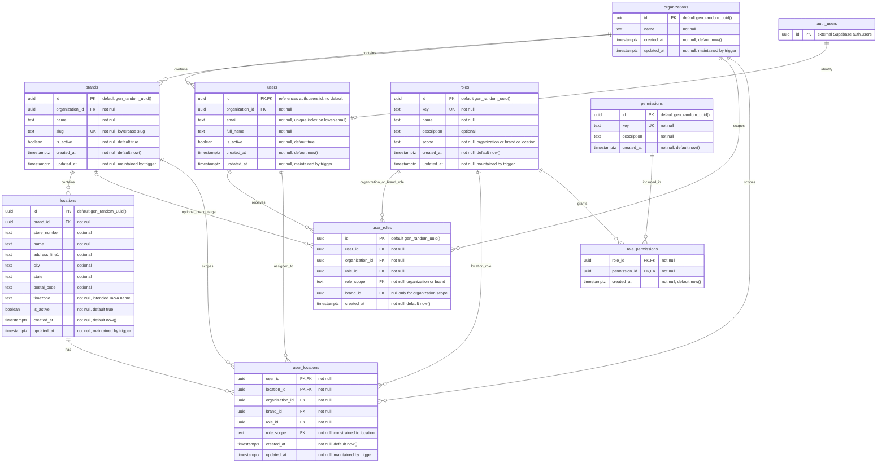

# Identity and Access Database Design

**Status:** Draft for company review. Migrations and authorization policies have not been implemented or tested.

**Target:** PostgreSQL 15+, Supabase Auth, Express + TypeScript, and Next.js.

## Purpose and scope
There are nine application tables. Supabase's existing `auth.users` table is shown as `auth_users` for reference; the project does not create or manage its schema.

Task and checklist tables are designed separately. They will reference brands, locations, and users and follow the same consistency and access conventions. Production deployment is outside the capstone scope.

## Key design decisions

- Gala is the initial organization. Each user belongs to one organization, but can have assignments in several of that organization's brands. Organization membership alone grants no operational access.
- Three role scopes define the access boundary: `organization`, `brand`, and `location`. Permissions define the actions allowed within that boundary.
- `user_roles` holds organization and brand assignments. Organization assignments apply across the assigned organization, including newly added brands. Brand assignments apply to one specified brand.
- `user_locations` holds one location role per user per store. A user can be a manager at Store A and an employee at Store B. Multiple simultaneous location roles at the same store are outside this design.
- Applicable role permissions combine. A location permission never extends to a different store solely because both stores belong to the same brand.
- Users have no `brand_id`; role assignments determine access. There is no separate brand-membership table in this design.
- Scope checks and composite foreign keys enforce which assignment table may reference each role. A missing brand ID alone never grants organization access.
- Composite foreign keys ensure the user and target brand belong to the same organization, and the target location belongs to that brand.
- Roles and permissions are shared reference data, changed only through reviewed migrations. Assigning existing roles to users is a separate, permission-controlled operation.
- An assigned role cannot be deleted. Its assignments must first be explicitly removed or reassigned through an authorized, audited process.
- Users, brands, and locations are normally deactivated rather than deleted. Assignment tables represent current access; historical role changes require the planned audit log.

## Access examples

These role names illustrate the design. The exact role-permission and role-grant matrices require review.

| Person | Assignment | Storage | Access boundary |
| --- | --- | --- | --- |
| GCP operations lead | `org_admin` for Gala | `user_roles`, organization scope, `brand_id = NULL` | All brands in Gala |
| Nancy | `brand_admin` for Brand A | `user_roles`, brand scope, Brand A's ID | All stores in Brand A |
| Bob | `location_manager` at Store A | `user_locations`, Store A's ID | Store A |
| Bob | `employee` at Store B | A second `user_locations` row | Store B |

Promotion from brand administrator to organization administrator adds an organization assignment. Remove the old brand assignment if the promotion is intended to replace it; otherwise it remains effective and must be considered during later demotion. The user's identity does not change.

## Entity relationship diagram



## Database constraints

Mermaid displays individual columns and relationships. The following tables specify composite constraints that must be implemented in migrations.

### Keys and field conventions

- Entity tables and `user_roles` use UUID `id` primary keys with `gen_random_uuid()`, except `users.id`, which references the existing `auth.users.id` and has no default.
- `user_locations` uses primary key `(user_id, location_id)`.
- `role_permissions` uses primary key `(role_id, permission_id)`.
- All foreign-key columns are required except `user_roles.brand_id`, whose nullability is governed by assignment scope.
- Emails are required and unique through an index on `lower(email)`. Supabase Auth is authoritative for login email; the application copy must be synchronized.
- `brands.slug`, `roles.key`, and `permissions.key` are individually unique. Brand slugs use lowercase letters, numbers, and single separating hyphens.
- Location timezones must be valid supported IANA names. Validation implementation and timezone-change behavior are review items.
- `created_at` and `updated_at` default to `now()`. A shared `set_updated_at()` trigger maintains `updated_at` on every update to a table with that column.

### Composite unique constraints

| Table | Constraint | Purpose |
| --- | --- | --- |
| `users` | `UNIQUE (id, organization_id)` | Target for organization-consistent user references |
| `brands` | `UNIQUE (id, organization_id)` | Target for organization-consistent brand references |
| `brands` | `UNIQUE (organization_id, name)` | Prevent duplicate exact brand names within an organization |
| `locations` | `UNIQUE (id, brand_id)` | Target for brand-consistent location references |
| `locations` | `UNIQUE (brand_id, store_number)` | Prevent duplicate non-null store numbers within a brand; multiple unknown numbers remain allowed |
| `roles` | `UNIQUE (id, scope)` | Target for scope-consistent role references |
| `user_roles` | `UNIQUE NULLS NOT DISTINCT (user_id, role_id, brand_id)` | Prevent duplicate brand assignments and duplicate organization assignments with null brands |

`NULLS NOT DISTINCT` requires PostgreSQL 15 or later. Since each user belongs to exactly one organization, the user's ID also fixes the organization of an assignment.

### Composite foreign keys

| Referencing table | Referencing columns | Referenced columns |
| --- | --- | --- |
| `user_roles` | `(user_id, organization_id)` | `users(id, organization_id)` |
| `user_roles` | `(brand_id, organization_id)` | `brands(id, organization_id)` |
| `user_roles` | `(role_id, role_scope)` | `roles(id, scope)` |
| `user_locations` | `(user_id, organization_id)` | `users(id, organization_id)` |
| `user_locations` | `(brand_id, organization_id)` | `brands(id, organization_id)` |
| `user_locations` | `(location_id, brand_id)` | `locations(id, brand_id)` |
| `user_locations` | `(role_id, role_scope)` | `roles(id, scope)` |

Both assignment tables also directly reference `organizations(id)` through `organization_id`.

The nullable brand reference in `user_roles` uses `MATCH SIMPLE`. When `brand_id` is null, the scope check and separate organization/user constraints still apply. `MATCH FULL` would incorrectly reject a valid organization assignment with a null brand and non-null organization.

### Scope checks

```sql
-- roles
CHECK (scope IN ('organization', 'brand', 'location'))

-- user_roles
CHECK (role_scope IN ('organization', 'brand'))
CHECK (
    (role_scope = 'organization' AND brand_id IS NULL)
    OR
    (role_scope = 'brand' AND brand_id IS NOT NULL)
)

-- user_locations
CHECK (role_scope = 'location')
```

All scope columns are `NOT NULL`. `user_locations.role_scope` defaults to `location`; the check enforces the value even when a caller supplies it explicitly. Composite role/scope foreign keys ensure the assigned role matches the declared scope.

### Delete and update behavior

Deletion behavior belongs to each foreign key, as specified below. Normal application workflows deactivate users, brands, and locations; the cascade rules cover deliberate physical deletion by authorized administration.

| Referenced parent | Referencing child / foreign key | ON DELETE |
| --- | --- | --- |
| `auth.users` | `users.id` | `RESTRICT` |
| `organizations` | `users.organization_id` | `RESTRICT` |
| `organizations` | `brands.organization_id` | `RESTRICT` |
| `brands` | `locations.brand_id` | `RESTRICT` |
| `organizations` | `user_roles.organization_id` | `RESTRICT` |
| `organizations` | `user_locations.organization_id` | `RESTRICT` |
| `users` | `user_roles(user_id, organization_id)` | `CASCADE` |
| `users` | `user_locations(user_id, organization_id)` | `CASCADE` |
| `brands` | `user_roles(brand_id, organization_id)` | `RESTRICT` |
| `brands` | `user_locations(brand_id, organization_id)` | `RESTRICT` |
| `locations` | `user_locations(location_id, brand_id)` | `CASCADE` |
| `roles` | `user_roles(role_id, role_scope)` | **`RESTRICT`** |
| `roles` | `user_locations(role_id, role_scope)` | **`RESTRICT`** |
| `roles` | `role_permissions.role_id` | `CASCADE` |
| `permissions` | `role_permissions.permission_id` | `CASCADE` |

All foreign keys use `ON UPDATE RESTRICT`. Moving entities between organizations or brands requires a deliberate migration or dedicated workflow; foreign-key updates must not silently retarget assignments.

Deleting an assigned role fails and leaves its assignments and permission links intact. Deleting an unassigned role removes its `role_permissions` links. Deleting a permission removes its grants and is therefore a security-sensitive catalog migration requiring review.

The Auth foreign key prevents physical deletion of an Auth user while the application profile exists. Setting `app.users.is_active = false` denies application access; it does not itself disable Supabase authentication or revoke Auth sessions. Auth account deletion and data retention need a separate approved lifecycle procedure.

Deactivation preserves entity records, but it does not preserve overwritten or deleted assignments. The planned audit log must record these changes and must not disappear through cascades from users, roles, or locations.

### Indexes

Each referencing foreign key needs a suitable index unless an existing primary-key or unique index already covers its leading columns. A composite index can satisfy this requirement; do not add redundant single-column indexes blindly.

| Table | Required index coverage |
| --- | --- |
| `users` | `(id)` through the primary key; `(organization_id)`; unique `lower(email)` |
| `brands` | `(organization_id)` covered by `UNIQUE (organization_id, name)` |
| `locations` | `(brand_id)` covered by `UNIQUE (brand_id, store_number)` |
| `user_roles` | `(user_id, organization_id)`, `(brand_id, organization_id)`, `(role_id, role_scope)`, `(organization_id)` |
| `user_locations` | `(user_id, organization_id)`, `(brand_id, organization_id)`, `(location_id, brand_id)`, `(role_id, role_scope)`, `(organization_id)` |
| `role_permissions` | `(role_id)` covered by the primary key; separate `(permission_id)` |

The composite unique constraints above create additional indexes. Final query plans should be checked using realistic seed data and the application database role.

## Planned authorization and RLS approach

### Scope and action checks

- `current_user_brand_ids()` returns accessible brands based on organization, brand, and location assignments.
- `current_user_location_ids()` returns accessible stores. Organization and brand assignments cover their respective stores; location assignments cover only their assigned stores.
- Brand-owned records use the accessible-brand boundary. Location-owned records additionally use the accessible-location boundary.
- A location assignment makes the brand discoverable but does not grant visibility of every store or every category of data in that brand.
- `users`, `organizations`, and organization-scoped `user_roles` require separate visibility policies because they cannot be filtered directly by a non-null `brand_id`.
- Any effective-permissions view retains user, permission, scope, organization, brand, and location. Permissions must not be flattened into an unscoped list.
- The API checks action permissions against the resource's actual target, resolved from trusted data. The role-grant matrix must define which roles each administrator may assign and at which scope.
- SELECT, INSERT, UPDATE, and DELETE policies are designed separately. Updates validate existing rows with `USING` and proposed rows with `WITH CHECK`.
- No operation receives runtime grants until its authorization path is defined. Missing identity or assignments must not grant access.

### Trusted request context and helpers

- Express verifies the JWT and sets `app.user_id` transaction-locally on the same checked-out database connection used for permission checks and application queries.
- The runtime role does not own tables, has no `BYPASSRLS`, and cannot become the helper-owner role. RLS tests run as this runtime role.
- RLS helpers are `STABLE`, with controlled `SECURITY DEFINER` ownership, a fixed search path, fully qualified object names, and restricted execution grants.
- The helper owner must be able to read authorization tables without recursively invoking their policies. A dedicated `NOLOGIN` role with narrowly limited SELECT privileges and `BYPASSRLS` is the proposed approach, subject to verification in the company's Supabase environment.
- Internal helpers accepting arbitrary user IDs are not exposed to the runtime role or browser. Public policy helpers derive the caller from verified request context.
- Any permissions view uses `security_invoker = true` unless a separately reviewed definer design is required. Views and helpers must not reintroduce policy recursion.
- The application still filters queries by the requested authorized brand and location; RLS provides a second boundary.
- Connection reuse must not leak identity between requests. Queries without context fail closed; transactions are committed or rolled back before release.

Application database credentials are backend-only. The database trusts Express to set the actor correctly; the session setting is not an independently authenticated credential.

### Activity and history

Inactive users must lose application access on subsequent requests even if their JWT has not expired. Role changes must be evaluated from current assignments rather than relying solely on stale JWT role claims.

Proposed behavior for inactive brands and locations: block operational writes and ordinary operational access, while allowing historical reads only through an explicitly authorized reporting path. Reviewer confirmation is required before finalizing those policies.

## Lifecycle work outside the nine-table core

- **Invitations:** define authorized provisioning, acceptance, expiration, retries, and activation. An `invitations` table is proposed if tracking these states is required. New profiles without assignments require a controlled provisioning path.
- **Email synchronization:** Supabase Auth owns login email. Choose and test synchronization into `users.email`, including existing-user reconciliation and failed updates. Identity and assignments always use UUIDs.
- **Audit history:** a planned `audit_log` records assignment changes, deactivation, and permission-catalog changes, including actor, target, before/after values, timestamp, and request ID. Runtime users cannot directly forge, update, or delete audit records. System jobs need an explicit actor convention.
- **Timezones:** validate supported IANA names and decide how location timezone changes affect future task generation and existing task instances.

These workflows are not represented as completed migrations in this proposal.

## Required validation before handoff

- Reject cross-organization assignments, wrong-brand locations, wrong-scope roles, and duplicate assignments, including organization assignments with null brand IDs.
- Reject deletion of a role referenced by either assignment table; allow deliberate deletion of an unassigned role and cleanup of its permission links.
- Verify an employee cannot access another store's operational records in the same brand without an applicable assignment.
- Verify a manager at Store A has only their assigned employee permissions at Store B.
- Verify brand administrators cannot access another brand and organization administrators cannot access another organization. Include a second synthetic organization in tests.
- Reject self-promotion and unauthorized broader grants according to the approved role-grant matrix.
- Verify role revocation and user deactivation remove access on subsequent requests.
- Verify context isolation after both commit and rollback, including concurrent requests through the intended pooler mode.
- Verify direct SQL as the runtime role remains subject to RLS, including unsafe attempted INSERT and UPDATE targets.
- Verify audit records survive assignment deletion and cannot be modified by the runtime role.

## Open questions

1. Does organization scope represent the requested higher-level access across all Gala brands? Do those users need consolidated reporting, brand switching, or both?
2. What exact permissions belong to each initial role, and which roles may each administrator grant, revoke, or replace?
3. Should employees see only users at their stores, or all users who share an accessible brand? Who can inspect organization-role assignments?
4. Is the proposed inactive brand/location behavior correct, and which roles may read historical records?
5. How should invitations, existing Auth accounts, email synchronization, and first-administrator provisioning work?
6. Which timezone names are accepted, and how should timezone changes affect checklist scheduling?
7. What audit retention and account-deletion procedures does the company require?

After review, finalize the access and role-grant matrices and translate this specification into versioned migrations. The diagram alone is not evidence that constraints or policies have been implemented or tested.
